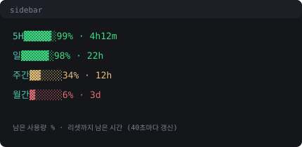

# opencode-go-usage (TUI plugin)

[English](README.md) | **한국어**

OpenCode **Go / Go Plus** 구독 중이라면 이 플러그인 하나로 사이드바에서 남은 사용량과 리셋 시각을 확인할 수 있다.

```
5H   ▓▓▓▓▓░ 99% · 4h12m   ← 남은 99%, 5시간 창 리셋까지 4h12m
일   ▓▓▓▓▓░ 98% · 22h     ← 24h 기준
주간  ▓▓▓▓▓░ 96% · 1d2h   ← 다음 월요일 00:00 기준
월간  ▓▓▓▓▓░ 82% · 15d    ← 다음달 1일 00:00 기준
```

- **남은 사용량(%)** = Go 규칙 근사 (5H = 월한도의 20%, 주간 = 50%, 월간 = 100%)
- 남은량 기준 색상: 초록(40%↑) / 노랑(40%↓) / 빨강(10%↓)
- 40초마다 자동 갱신 (옵션으로 조정 가능)
- `$` / 소계 없음 — % · 바 · 리셋시간만

## 설치 (다른 컴퓨터)

**한 줄 클론 — cli.json 수정 불필요, node_modules 불필요:**

```sh
git clone https://github.com/HaYanJongSeong/opencode-go-usage \
  ~/.config/opencode/plugins/opencode-go-usage
```

OpenCode는 `<global-config>/plugins/<name>/tui.tsx` 경로의 플러그인을 자동으로 발견하기 때문에 위 경로만으로 충분하다.

`~/.config/opencode/cli.json`에 직접 적는 방식:

```json
{
  "plugins": [
    {
      "package": "~/.config/opencode/plugins/opencode-go-usage",
      "options": { "plan": "go" }
    }
  ]
}
```

## 동기화 시점

| 시점 | 동작 |
| --- | --- |
| TUI 시작 직후 | 즉시 1회 계산·렌더 |
| `refreshSec`마다 (기본 40초, 최소 10초) | 세션·메시지 기록 다시 읽어 잔량·리셋 재계산 |
| 세션/메시지 데이터 변경 | 다음 리프레시 주기에 반영 (푸시 아님, 폴링 방식) |

콘솔 서버에서 사용량을 밀어주는 게 아니라 로컬 기록을 폴링하는 방식이기 때문에, 터미널을 닫아두면 그 사이 갱신이 걷지 못해 화면 UX는 유지된다.

## 예시 화면



## 옵션

| 옵션            | 기본값  | 설명                                            |
| --------------- | ------- | ----------------------------------------------- |
| `plan`          | `"go"`  | `"go"` 또는 `"goplus"` (한도 표 기준 변경)      |
| `refreshSec`    | `40`    | 갱신 주기(초), 최소 10                          |
| `monthlyLimits` | —       | 모델별 월한도 수동 보정, 예 `{ "glm-5.3": 60 }` |

## 데이터 출처와 한계

계산에 쓰는 건 **로컬 서버(DB)가 들고 있는 세션·메시지 기록**이다. 모델별 cost와 시각을 여기서 읽는다.

- 다른 폴더(별도 서버 인스턴스/프로젝트)에서 쓴 세션은 합산에서 빠질 수 있음
- 리셋 시각은 서버 공식 `resetsAt`이 아니라 위 창 기준의 근사치
- [opencode.ai/console](https://opencode.ai/console) → **Usage**의 공식 잔량과 완전히 같지는 않다

## 라이선스

MIT
