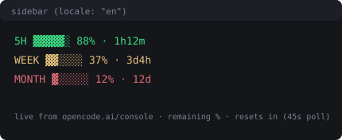

# opencode-go-usage (TUI plugin)

**English** | [한국어](README.ko.md)

An [OpenCode](https://opencode.ai) CLI plugin that puts your **OpenCode Go / Go Plus** usage in the TUI **sidebar**: how much room is left in each window, and when it resets.

```
5H    ▓▓▓▓▓░ 88% · 1h12m   ← 5-hour window
주간  ▓▓░░░░ 37% · 3d4h    ← weekly
월간  ▓░░░░░ 12% · 12d     ← monthly
```

- Reads the same meters as [Console](https://opencode.ai/console) → Usage, so the numbers match what the plan actually enforces
- Color by headroom: green (≥40%) / yellow (<40%) / red (≤10%)
- Refreshes every 45 seconds by default
- No dollar amounts, no totals — just percentage, bar, and reset ETA per row
- If the console can't be reached (offline, expired login) it falls back to a rough local estimate and marks the row with `~`

Labels are `5H / 주간 / 월간` by default; set `"locale": "en"` for `5H / WEEK / MONTH`.

## Install (other machines)

**One-liner via git — no cli.json edits, no node_modules:**

```sh
git clone https://github.com/HaYanJongSeong/opencode-go-usage \
  ~/.config/opencode/plugins/opencode-go-usage
```

OpenCode discovers plugins under `<global-config>/plugins/<name>/tui.tsx` automatically, so this path alone is enough.

If you prefer `~/.config/opencode/cli.json`:

```json
{
  "plugins": [
    {
      "package": "~/.config/opencode/plugins/opencode-go-usage",
      "options": { "locale": "en" }
    }
  ]
}
```

## npm (planned / manual)

```sh
git clone https://github.com/HaYanJongSeong/opencode-go-usage
cd opencode-go-usage
npm publish
```

## Options

| Option          | Default  | Notes                                                              |
| --------------- | -------- | ------------------------------------------------------------------ |
| `plan`          | `"go"`   | `go` or `goplus` — limits table used only by the local fallback     |
| `refreshSec`    | `45`     | Poll cadence in seconds, minimum 10                                 |
| `locale`        | `"ko"`   | `"en"` switches row labels to `5H/WEEK/MONTH`                       |
| `source`        | `"auto"` | `auto` (console, then local) · `api` (console only) · `local`       |
| `monthlyLimits` | —        | Per-model overrides for the local fallback, e.g. `{ "glm-5.3": 60 }` |

## When does the widget update?

| When                       | What happens                                    |
| -------------------------- | ----------------------------------------------- |
| TUI start                  | One fetch + render immediately                  |
| Every `refreshSec` seconds | Re-reads the console meters                     |
| Usage moves                | Shows up on the next poll (polling, not push)   |

Response caching is 15 seconds, so a very short `refreshSec` won't hammer the console.

## Example screenshot




## Where the numbers come from

`GET https://opencode.ai/console/api/go/status`, with the OpenCode login token already on disk (the `opencode` credential in `~/.local/share/opencode/opencode.db`) — the same credential the CLI uses. The response carries one meter per window:

```
fiveHour · week · month   →   usedMicroCents, limitMicroCents, resetsAt
```

Remaining % is `1 - used/limit`, and the countdown is `resetsAt` minus now, so the rows track the Console (and the `retry-after` you get when the 5-hour limit is spent).

The token is only read. The plugin never refreshes, rotates, or writes it.

### The fallback

If the console call fails, the plugin sums local session records instead (per-message `cost` and timestamp, per model, against the monthly limits from the [Go plan docs](https://opencode.ai/v2/docs/console/go)) and appends `~` to the rows. That estimate runs low compared to the server's accounting, so treat it as a last resort — it's what you'd see while offline.

## License

MIT
